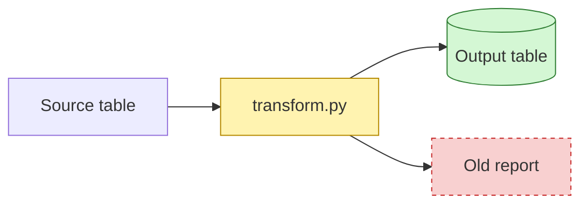

# PR Explainer

Make a change easy for a human to understand and to judge. The reader must know three things in under two minutes:

1. **What** changed and **why**.
2. **How far** a wrong change can spread (blast radius).
3. **Can we undo it** (one-way or two-way door).

This skill explains. It does not review for bugs. It does not edit code.

## Procedure

1. Get the change.
   - PR: `gh pr view <n> --json title,body,files,additions,deletions,baseRefName` and `gh pr diff <n>`.
   - Local branch: `git diff origin/<base>...HEAD` and `git diff --stat origin/<base>...HEAD`.
2. Read the diff. Read the surrounding code when a hunk is not clear alone.
3. Find the consumers of each changed item. Grep the repo for changed functions, classes, table names, columns, endpoints, config keys, env vars, and job names. Check for:
   - shared modules or libraries that other code imports;
   - published packages, APIs, or schemas that other repos read;
   - tables or views that other teams, dashboards, or jobs read;
   - CI workflows, Terraform or other IaC, scheduled jobs, and deploy config;
   - external sends: email, SMS, push, webhooks, callbacks, third-party APIs, payments.
4. Classify the blast radius and the door for each risky action (rules below).
5. Write the output with the template below. Obey the writing rules.
6. Render the change map. Save the mermaid block to `change-map.mmd` in a scratch directory. Then run these commands from that directory:
   ```bash
   mmdc -i change-map.mmd -o change-map.svg -b white   # also -o change-map.png for a preview image
   ```
   If `mmdc` is not installed, use `npx -y @mermaid-js/mermaid-cli` after you ask the user. If `mmdc` says "Could not find chrome-headless-shell", point it at the installed Chrome:
   ```bash
   echo '{"executablePath":"/Applications/Google Chrome.app/Contents/MacOS/Google Chrome","headless":"new"}' > pptr.json
   mmdc -p pptr.json -i change-map.mmd -o change-map.png -b white -s 2
   ```
   A failed render means the syntax is wrong, so fix it. Open the image (`open change-map.png` on macOS) or show it to the user.
7. Print the result in the chat. To update the PR body or post a comment, show the text first. Run `gh pr edit <n> --body-file <file>` or `gh pr comment <n> --body-file <file>` only after the user says yes. GitHub renders the ` ```mermaid ` block, so do not attach the image.

If you cannot find who reads a changed item, write "Unknown consumers" and treat the radius as one level higher.

## Output template

Use these sections in this order. Remove a section only if it does not apply, and say why in one line.

````markdown
## Why
<1–3 sentences: the problem, then the result of this change.>

## Change map

Legend: yellow = changed, green = new, red dashed = removed.

## Key changes
**1. <short title>** — `path/to/file.py`
```diff
- old line
+ new line
```
Why: <one sentence>

<3–5 items. Most important first.>

## Blast radius: <Local | Repo | Cross-repo | External>
| Impacted item | Level | How it is impacted |
|---|---|---|
| `module.func` callers (3) | Repo | Signature changes |

## Door
| Action | Door | Undo / gate |
|---|---|---|
| Code change | 🔁 Two-way | Revert the PR |
| Sends email to users | 🚪 One-way | Gate: dry run on test list + named approver before merge |
| Turn on a new recommendation model / feature flag (not in this PR) | ⏳ Two-way → one-way | One-way once a downstream system consumes the output. Gate: separate PR + staging check |

## Test evidence
- <command or check> → <result>
````

### Change map rules

- Use one `flowchart` (`LR` for pipelines, `TD` for call trees).
- Show 12 nodes or fewer. Group small files into one node.
- Show components and data or control flow. Do not show every function.
- Mark nodes with the `changed`, `new`, and `removed` classes. Leave the other nodes plain.
- Put labels with special characters in quotes: `A["load(df)"]`.
- For a before/after logic change, you can use two `subgraph` blocks named `Before` and `After`.
- Put items of the same type (input tables, config files, jobs) in one `subgraph`. A subgraph counts as 1 node toward the limit.
- Use a dotted arrow (`-.->`) for an optional path or a path that a later PR turns on. Add a label, for example `-. "enabled: true (later)" .->`.
- Before you print, render the diagram to check the syntax (see step 6 of the procedure). If the render fails, fix the diagram. Do not print a diagram that does not render.

### Key changes rules

- Trim each hunk to the lines that carry the meaning (10 lines or fewer).
- Do not show generated files, lockfiles, formatting-only changes, or renames that have no edits. Count them in one line: "Also: 4 lockfile and formatting changes."
- Give each hunk one `Why:` line. Explain the reason, not the syntax.

## Blast radius

Pick the **highest** level that any changed item reaches.

| Level | Meaning | Examples |
|---|---|---|
| **Local** | Only this file or module. No other code reads it. | Private helper, test, internal doc |
| **Repo** | Other code in this repo reads it. | Shared util, base class, CI workflow, repo config |
| **Cross-repo** | Other repos, teams, or services read it. | Shared table or schema, published package, API contract, shared Terraform module, shared secret or permission |
| **External** | People or systems outside engineering see the effect. | Users, customers, prod data that is consumed downstream, third-party partners, regulators |

Data and infrastructure changes have a larger radius than they look:
- A column rename in a table that other jobs read is **Cross-repo**, even if the diff is 1 line.
- A grant, permission, or network rule change is **Cross-repo** at minimum.
- A change to a prod job or model that writes results that people use is **External**.

## Door

Classify each risky action, not the PR as a whole. A PR is one-way if any of its actions is one-way.

**🔁 Two-way door.** You can undo it, and nothing persists outside the system. State how to undo it:
- Revert the PR and redeploy.
- Turn off a feature flag.
- Restore a table with Delta time travel (only inside the retention window).
- Roll back a model alias or a serving endpoint version.

**🚪 One-way door.** You cannot fully undo it. Examples:
- Email, SMS, push, or other message sent to people.
- Data deleted or overwritten past the retention or backup window. `DROP TABLE`, `VACUUM`, a truncate.
- A schema migration that drops columns or changes types in place.
- A published package version, a public API response, or a data export that others already took.
- A secret or PII / sensitive data exposed in logs, commits, or a third-party system.
- Prod predictions or decisions that downstream systems or people already acted on.
- Payments, orders, or other external transactions.

For each one-way action, name the **gate** that must happen before merge or run. Examples: a dry run on a test audience, a backup snapshot, a named approver, a staged rollout to 1%.

**⏳ Two-way → one-way.** Use this label when the change can be undone now but not after someone acts on it, or after a time limit. Say what makes it one-way and when that happens. Examples:
- Changed model outputs are two-way until a downstream system consumes them.
- A table overwrite is two-way until the time-travel retention expires.

Use only the three labels: 🔁 Two-way, 🚪 One-way, and ⏳ Two-way → one-way.

An action that this PR enables but does not turn on (for example, a flag that stays `false`) goes in the Door table, marked "(not in this PR)". Give the gate that must happen before someone turns it on.

## Writing rules (STE100 subset)

Use ASD-STE100 Simplified Technical English principles:

1. Write short sentences: 20 words or fewer for steps, 25 words or fewer for descriptions.
2. Write one topic per sentence and one instruction per step.
3. Use the active voice. "The job writes the table," not "The table is written."
4. Use the present tense. Use the imperative for steps ("Run the tests").
5. Use one term for one thing. If you call it "the loader," do not later call it "the ingest service."
6. Use common words. Do not use idioms, metaphors, filler, hedging, or intensifiers.
7. Use numbers, not vague words: "3 jobs," not "several jobs."
8. Use a table or list when you write about 3 or more items of the same type.
9. Write the title of a table, file, or function in `code` style.

Word swaps:

| Do not write | Write |
|---|---|
| utilize, leverage | use |
| in order to | to |
| ensure | make sure |
| facilitate | help, let |
| prior to | before |
| a number of, various | <the count> |
| robust, seamless, comprehensive, powerful | *(delete)* |
| it should be noted that | *(delete)* |
| in the event that | if |
| is able to | can |
| this PR aims to | this PR |

Before you print the output, read it one time and fix each sentence that breaks a rule.

## Guardrails

- Do not put PII / sensitive data, secrets, or real record values in the output. Use column names and counts, not row values.
- Do not run, deploy, or edit anything. This skill only reads and explains.
- Do not post to GitHub without the user's approval.
- If the diff is too large to read in full (more than about 3,000 changed lines), say so. Explain the top-level structure, and list the files you did not read.
